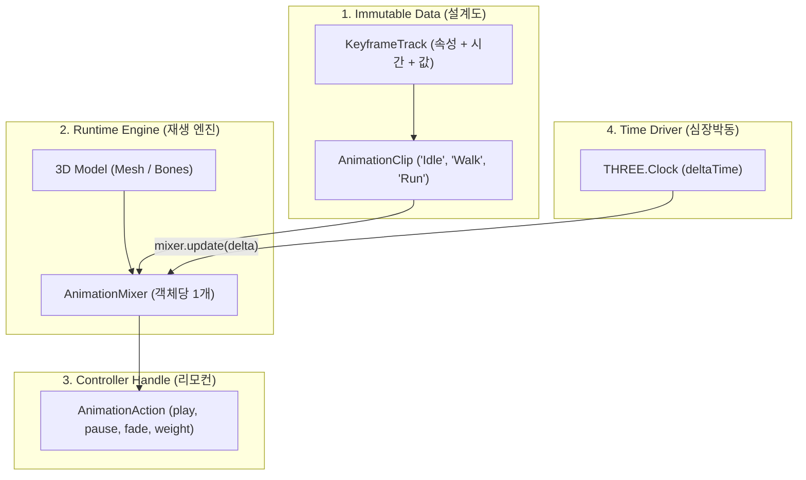

# Three.js Animation System: A Principal Engineer's Guide

> **"초보자는 메쉬를 직접 회전시키고, 시니어는 트랙을 이해하며, 프린시펄은 데이터와 런타임 제어의 분리(Separation of Concerns)를 봅니다."**

Three.js 공식 문서([Animation System Manual](https://threejs.org/manual/#animation-system))를 처음 읽으면 수많은 클래스 이름(`KeyframeTrack`, `AnimationClip`, `AnimationMixer`, `AnimationAction`) 때문에 압도되기 쉽습니다.

하지만 본질은 단 하나입니다: **"상태(State)와 불변 데이터(Data), 그리고 시간(Time)의 명확한 분리"**입니다.

---

## 1. Mental Model: 4단계 핵심 계층 구조

Three.js 애니메이션 시스템은 복잡한 3D 본(Bone) 변형이나 모프 타깃(Morph Target)을 효율적으로 다루기 위해 역할을 4개로 쪼갰습니다.



| 구성 요소 | 역할 | 비유 | 특징 |
|---|---|---|---|
| **`AnimationClip`** | 애니메이션의 순수 데이터 (키프레임, 타임스탬프) | **LP 음반 / 악보** | 상태가 없음(Stateless), 불변(Immutable). 100명의 군인이 있어도 메모리에 1개만 로드되어 공유됨 |
| **`AnimationMixer`** | 특정 3D 객체에 바인딩되어 시간을 평가하는 플레이어 | **LP 턴테이블 / 재생기** | 모델 인스턴스마다 1개씩 존재. 현재 시간을 추적하고 여러 트랙을 합성(Blending) |
| **`AnimationAction`** | 특정 클립을 믹서에서 어떻게 재생할지 제어하는 핸들 | **리모컨 / 재생 버튼** | `play()`, `stop()`, `crossFadeTo()`, `timeScale`, `weight` 등을 조작 |
| **`mixer.update(delta)`** | 렌더 루프에서 시간을 한 틱 전진시키는 동력 | **전원 모터** | `delta` 시간이 없으면 애니메이션은 멈춰 있음 |

---

## 2. 가장 핵심이 되는 코드 (The Core Essence)

모든 화려한 부가 코드를 걷어내고, **엔진의 뼈대가 되는 핵심 코드는 단 6단계**입니다:

```javascript
import * as THREE from 'three';
import { GLTFLoader } from 'three/examples/jsm/loaders/GLTFLoader.js';

// 1. 모델과 클립 데이터 로드
const loader = new GLTFLoader();
loader.load('/models/Soldier.glb', (gltf) => {
  const model = gltf.scene;
  scene.add(model);

  // 2. [Mixer] 특정 모델에 재생 엔진 바인딩
  const mixer = new THREE.AnimationMixer(model);

  // 3. [Clip -> Action] 클립 데이터를 기반으로 제어 리모컨 생성
  const idleClip = gltf.animations.find(clip => clip.name === 'Idle');
  const action = mixer.clipAction(idleClip);

  // 4. [Action] 재생 명령
  action.play();
});

// 5. [Time Loop] 매 프레임 경과 시간(delta)만큼 믹서 전진
const clock = new THREE.Clock();

function animate() {
  requestAnimationFrame(animate);

  const delta = clock.getDelta();
  if (mixer) mixer.update(delta); // 여기가 심장박동

  renderer.render(scene, camera);
}
animate();
```

---

## 3. 현업에서 마주치는 3대 핵심 테크닉

### 테크닉 1: 부드러운 애니메이션 전환 (Cross-Fading)
정지(`Idle`) 상태에서 걷기(`Walk`)로 바로 넘어가면 캐릭터가 뚝 끊깁니다. 
이전 모션의 가중치를 줄이고(Fade Out), 다음 모션의 가중치를 높이는(Fade In) 크로스페이드가 필수입니다.

```javascript
function transitionTo(newAction, duration = 0.5) {
  newAction.reset(); // 타임라인을 0초로 리셋
  newAction.setEffectiveWeight(1.0); // 가중치 100%
  newAction.crossFadeFrom(currentAction, duration, true); // 부드럽게 보간
  newAction.play();
  currentAction = newAction;
}
```

### 테크닉 2: 속도 제어 & 역재생 (TimeScale)
슬로우 모션이나 슬로우 런닝 연출은 `timeScale` 하나로 끝납니다.
```javascript
// 전체 배속 2배
mixer.timeScale = 2.0;

// 특정 클립만 역재생
action.timeScale = -1.0;
```

### 테크닉 3: 1회 재생 후 대기 (LoopOnce & ClampWhenFinished)
사망(`Death`)이나 점프(`Jump`) 같은 1회성 동작:
```javascript
action.setLoop(THREE.LoopOnce);
action.clampWhenFinished = true; // 애니메이션의 마지막 프레임 자세 유지
action.play();
```

---

## 4. 구비된 3D 모델 정보

- **파일 위치**: `06-Animation/public/models/Soldier.glb` (2.1 MB)
- **포함된 애니메이션 클립**:
  1. `Idle`: 대기 상태 숨쉬기 모션
  2. `Walk`: 걷기 모션
  3. `Run`: 달리기 모션
  4. `TPose`: 기본 리깅 T포즈

---

## 5. 실행 방법

```bash
cd /Users/heejinchae/Documents/Dev/ThreejsMyJourney/06-Animation
npm run dev
```

브라우저에서 `http://localhost:5176`으로 접속하면 GUI 컨트롤러를 통해 모션 전환, 뼈대(Skeleton Bones) 시각화, 슬로우모션을 직접 체험할 수 있습니다.
